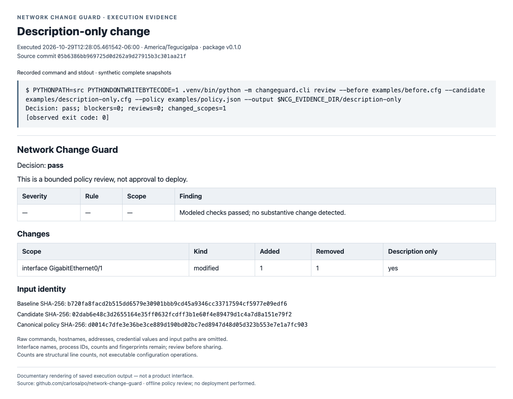
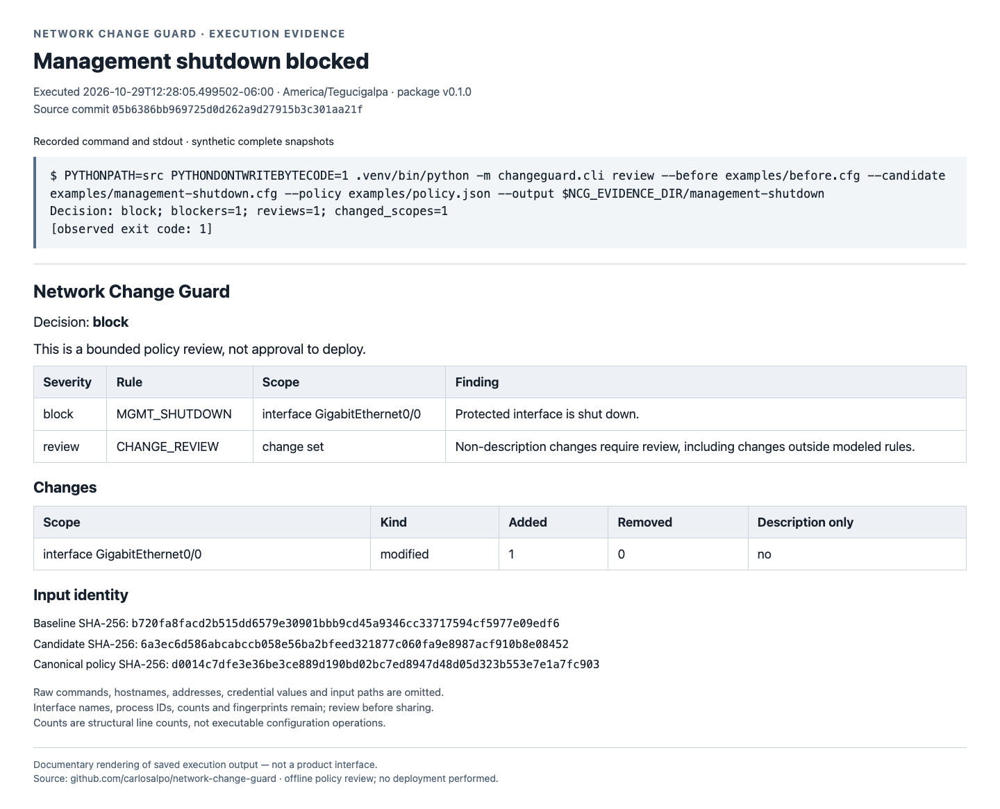
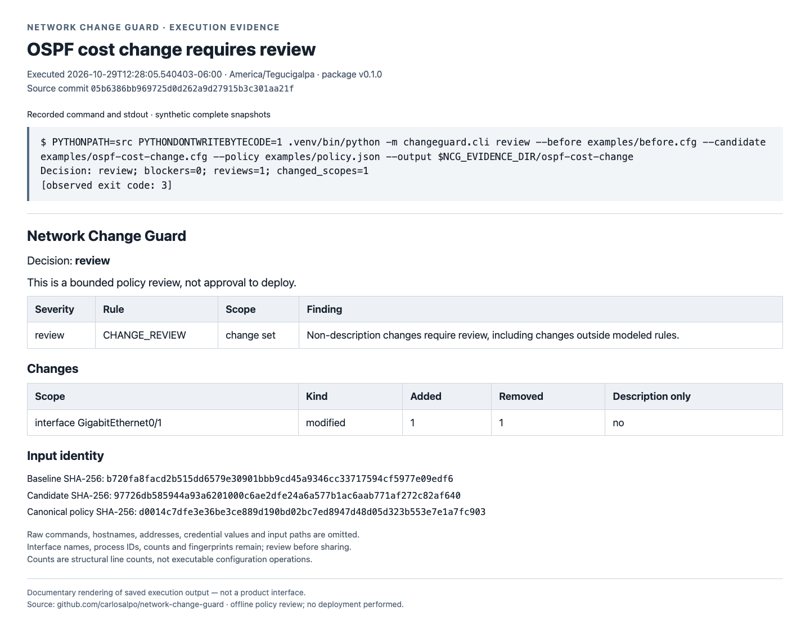
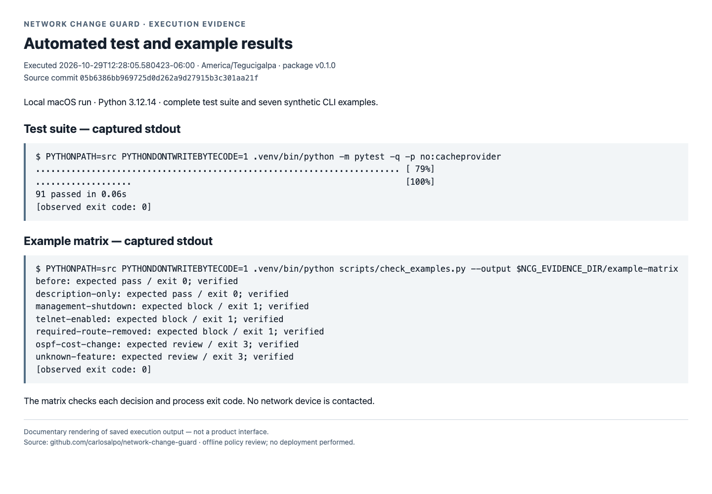
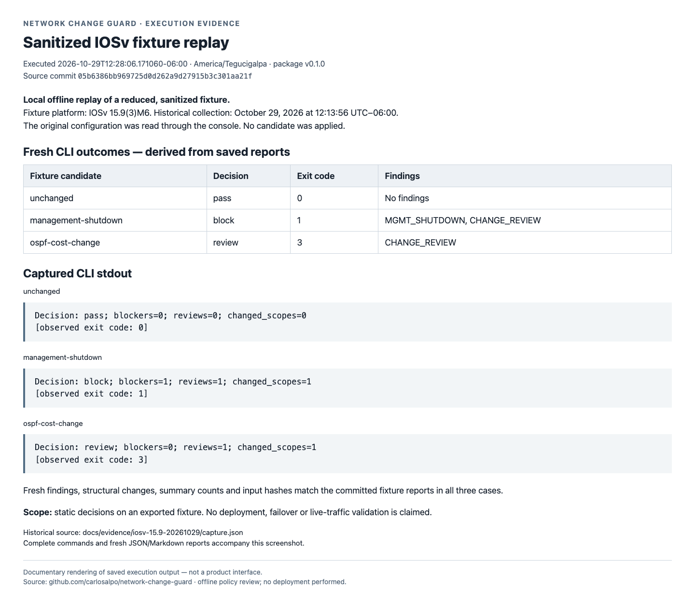

# Network Change Guard — visual test evidence

Browser screenshots of evidence documents rendered from actual CLI output and saved reports.
The executions used synthetic examples and the reduced sanitized IOSv fixture; no candidate was applied.

Captured on 2026-10-29 from source commit `05b6386bb969725d0d262a9d27915b3c301aa21f`, matching v0.1.0.

The [manifest](manifest.json) records source files, execution/capture times, image hashes and the portfolio selection.
All source transcripts, report files and HTML views accompany these images.

## Portfolio selection

The management-shutdown and OSPF-cost images demonstrate blocking an invariant violation and requiring human review for a technical change.

## Description-only change

A description-only edit passes the bounded offline policy review (exit 0); the report records one cosmetic change and binds the result to input fingerprints.

Executed: `2026-10-29T12:28:05.461542-06:00`. Captured: `2026-10-29T18:30:36.115Z`.

Evidence: [description-only.txt](runs/20261029-capture-01/description-only.txt); [report.md](runs/20261029-capture-01/description-only/report.md); [report.json](runs/20261029-capture-01/description-only/report.json).

## Management shutdown blocked

Network Change Guard blocks a synthetic management-interface shutdown with MGMT_SHUTDOWN (exit 1), identifying the protected interface before any deployment.

Executed: `2026-10-29T12:28:05.499502-06:00`. Captured: `2026-10-29T18:30:36.276Z`.

Evidence: [management-shutdown.txt](runs/20261029-capture-01/management-shutdown.txt); [report.md](runs/20261029-capture-01/management-shutdown/report.md); [report.json](runs/20261029-capture-01/management-shutdown/report.json).

## OSPF cost change requires review

An OSPF interface-cost change requires human review (exit 3), even when no modeled blocking invariant is violated.

Executed: `2026-10-29T12:28:05.540403-06:00`. Captured: `2026-10-29T18:30:36.366Z`.

Evidence: [ospf-cost-change.txt](runs/20261029-capture-01/ospf-cost-change.txt); [report.md](runs/20261029-capture-01/ospf-cost-change/report.md); [report.json](runs/20261029-capture-01/ospf-cost-change/report.json).

## Automated test and example results

The local Python 3.12.14 run passes all 91 tests and verifies the expected decision and exit code for all seven committed synthetic scenarios.

Executed: `2026-10-29T12:28:05.580423-06:00`. Captured: `2026-10-29T18:30:36.488Z`.

Evidence: [tests.txt](runs/20261029-capture-01/tests.txt); [example-matrix.txt](runs/20261029-capture-01/example-matrix.txt); [matrix.json](runs/20261029-capture-01/example-matrix/matrix.json).

## Sanitized IOSv fixture replay

Offline replay of the reduced, sanitized IOSv 15.9(3)M6 fixture reproduces pass, block and review. The source capture was read-only on October 29, 2026; no candidate was applied to a router.

Executed: `2026-10-29T12:28:06.171060-06:00`. Captured: `2026-10-29T18:30:36.619Z`.

Evidence: [iosv-unchanged.txt](runs/20261029-capture-01/iosv-unchanged.txt); [report.json](runs/20261029-capture-01/iosv-unchanged/report.json); [iosv-management-shutdown.txt](runs/20261029-capture-01/iosv-management-shutdown.txt); [report.json](runs/20261029-capture-01/iosv-management-shutdown/report.json); [iosv-ospf-cost-change.txt](runs/20261029-capture-01/iosv-ospf-cost-change.txt); [report.json](runs/20261029-capture-01/iosv-ospf-cost-change/report.json).
